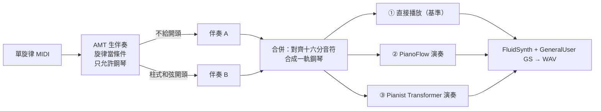

# 原型 01：旋律 → AMT 伴奏 → 表情鋼琴演奏

## 摘要

**問題：** 把現成的開源模型串起來，在 Mac M3 Pro 18GB 上，能不能把一段單旋律變成「願意拿給同事或老師聽」的鋼琴演奏？

**結論：有條件成立。**
- **演奏層可用。** PianoFlow 和 Pianist Transformer 都在 Mac 上跑得動，也都沒有改動任何音符。使用者的評價是「差強人意，但是也不是不能用」。
- **伴奏層不夠好。** AMT 生成的伴奏常有奇怪的和弦、和旋律對不上、和弦進行難聽。
- **還沒到放棄條件。** 使用者判斷可以再試一輪，方向是先決定和聲，再讓 AMT 生伴奏（見〈下一步〉）。

**主要的學習：**
1. 「拼現成模型」在工程上是可行的。三個模型、三個獨立的 Python 環境，用一個指令就能串起來。
2. 問題出在**控制**：AMT 沒有和聲的概念。這呼應研究計畫的「兩層架構」想法：控制要放在符號層。

> 原型花的力氣不代表正式版本要花的力氣。

## 1. 背景與動機

使用者是研究音樂能力測量的音樂心理學研究者，過去做過單旋律 MIDI 生成，之後不知道下一步。技術路線圖研究建議先不要從頭訓練，而是用現成的開源模型拼出「旋律→伴奏→演奏」的流程，從實作中累積經驗（[路線圖研究 建議 1](../../docs/research-music-generation-tech-roadmap/research-music-generation-tech-roadmap.md)）。

規劃文件：
- [原型計畫](../../docs/prototype-plan-melody-to-performance/prototype-plan-melody-to-performance.md)：要回答的問題、放棄條件、範圍。
- [模型查證](../../docs/research-prototype-model-check/research-prototype-model-check.md)：開工前查證 Aria、SyMuPe、AMT 能不能在 Mac 上用。
- [建置計畫](../../docs/plan-melody-to-performance-prototype.md)：實作規格、審查紀錄。

**動手前寫下的放棄條件：** 拿 3 段不同風格的旋律跑完整條流程。如果沒有一段的伴奏和旋律搭得起來，或者演奏聽起來和直接播放 MIDI 沒有明顯差別，就不再走「拼現成模型」這條路。

## 2. 方法

### 2.1 流程



每段旋律產出 2 種開頭 × 3 個版本，共 6 組 MIDI 和 WAV。

### 2.2 各步驟的意圖

| 步驟 | 做法 | 為什麼 |
|---|---|---|
| 輸入 | 3 段公有領域旋律：快樂頌（D 大調 4/4，29 秒）、綠袖子（A 小調 3/4，25 秒）、茉莉花（F 五聲 2/4，23 秒） | 三種風格，用來檢驗放棄條件 |
| AMT 伴奏 | 旋律放在 program 1，當 `controls`；生成時把鋼琴以外所有樂器的 logit 設成 −∞ | 讓 AMT「看著」旋律寫伴奏；只允許鋼琴，比較兩種開頭時才乾淨 |
| 兩種開頭 | `noprompt`：不給開頭；`chords`：前 2–3 小節放 I–IV–V–I 柱式和弦，AMT 從和弦結束處接著寫 | 查證發現沒有開頭時品質可能會掉（AMT issue #18），兩種都試，才分得出是哪個原因 |
| 合併 | 伴奏對齊到旋律的十六分音符格子，丟掉和旋律重複的音，合成一軌 | 兩個演奏模型都只吃「單軌、量化」的鋼琴譜；這一版直接播放就是基準 ① |
| 表情演奏 | PianoFlow 和 Pianist Transformer 各演奏一次，參數用預設值 | 比較兩個候選，決定留哪個 |
| 音符忠實度 | 比較輸入和輸出的音高（依起音排序，另算不看順序的計數） | 確認演奏模型沒有偷改音符 |
| 轉音檔 | FluidSynth＋使用者原有的 GeneralUser GS | 三個版本用同一個音色，差別才是演奏造成的 |
| 試聽頁 | `output/player.html`，附盲聽模式 | 方便自己比較，也方便拿給別人聽 |

### 2.3 環境

- 機器：Mac M3 Pro 18GB，沒有 CUDA。
- 三個模型的相依版本互相衝突，所以各用一個獨立的 uv 環境：AMT 用 Python 3.10（`transformers==4.29.2`），PianoFlow 和 Pianist Transformer 用 Python 3.11。
- 主流程用子行程呼叫各個環境。
- 程式碼：`prototype/melody-to-performance/`（GitHub 分支 `prototype/melody-to-performance`）。

## 3. 用到的模型

| 模型 | 角色 | 授權（程式碼／權重） | 卡片 |
|---|---|---|---|
| AMT music-medium-800k | 伴奏 | Apache-2.0／Apache-2.0 | [amt](../models/amt.md) |
| SyMuPe/PianoFlow-base | 表情演奏 | Apache-2.0／CC BY-NC-SA | [pianoflow](../models/pianoflow.md) |
| Pianist Transformer | 表情演奏 | Apache-2.0／Apache-2.0 | [pianist-transformer](../models/pianist-transformer.md) |
| Aria | 原本的候選，排除 | Apache-2.0 | [aria](../models/aria.md) |
| MAJEPPA | 備案，沒試 | MIT／非商用研究 | [majeppa](../models/majeppa.md) |

**為什麼排除 Aria：** 查證發現它只能續寫，不能照著給定的譜演奏（[模型查證](../../docs/research-prototype-model-check/research-prototype-model-check.md)）。

## 4. 結果

### 4.1 能不能跑（煙霧測試，8 秒片段）

| 模型 | CPU | MPS | 備註 |
|---|---|---|---|
| AMT | ✅ 每音 0.55–0.73 秒 | ✅ 每音約 0.23 秒 | 記憶體約 3GB |
| PianoFlow | ✅ | ✅（要把 float64 轉成 float32） | 記憶體約 0.5GB |
| Pianist Transformer | ✅ | ✅ | 記憶體約 0.6GB |

### 4.2 完整執行（CPU，只用鋼琴）

| 旋律 | 開頭 | AMT 伴奏音數 | AMT 耗時 | ① 長度 | ② PianoFlow 長度 | ③ Pianist 長度 | 音符保留 |
|---|---|---|---|---|---|---|---|
| 快樂頌 | 不給 | 28 | 32 秒 | 32.0 秒 | 45.3 秒 | 25.8 秒 | 全部 |
| 快樂頌 | 和弦 | 149 | 196 秒 | 32.6 秒 | 111.6 秒 | 27.2 秒 | 全部 |
| 綠袖子 | 不給 | 57 | 51 秒 | 28.7 秒 | 35.5 秒 | 23.8 秒 | 全部 |
| 綠袖子 | 和弦 | 64 | 76 秒 | 28.7 秒 | 53.7 秒 | 27.2 秒 | 全部 |
| 茉莉花 | 不給 | 128 | 162 秒 | 26.6 秒 | 19.6 秒 | 25.9 秒 | 全部 |
| 茉莉花 | 和弦 | 110 | 122 秒 | 26.6 秒 | 18.6 秒 | 26.8 秒 | 全部 |

### 4.3 觀察

- **兩個演奏模型都沒有改音符。** 6 個伴奏、12 次演奏，音高計數和輸入完全相同。
- **PianoFlow 不看譜上的速度。** 同一份譜設 60 或 240 bpm，輸出一樣長。快樂頌被彈慢最多 3.4 倍，茉莉花反而稍快。
- **Pianist Transformer 通常比原速快 10–30%。**
- **AMT 自己挑樂器。** 第一次執行時，不給開頭的版本挑了大鍵琴、吉他、直笛、小提琴、電貝斯。改成生成時只允許鋼琴後，6 份伴奏全是鋼琴，也沒有零長度音符。
- **只用鋼琴又不給開頭時，有重複單一音的傾向。** 快樂頌 28 個伴奏音裡有 46% 是同一個音高；綠袖子和茉莉花約三成。給和弦開頭的版本只有 12–15%。
- **給和弦開頭的版本，限定鋼琴前後結果相同**：AMT 本來就跟著開頭的樂器走，隨機種子也一樣。

### 4.4 使用者的聽感（2026-11-21）

- **伴奏：** 「生成的伴奏品質都不是很好。有的時候會有奇怪的和弦，或是對不上，或是和弦的進行很難聽。」
- **演奏：** 「兩個演奏模型，表現都是差強人意，但是也不是不能用。」
- **判斷：** 還不到 AMT 的放棄條件，可以再試一輪。

## 5. 討論：伴奏為什麼不好

以下是推論，還沒驗證。

**我們自己造成的：**
- 開頭和弦寫死成 I–IV–V–I，沒有看旋律，前幾小節可能和旋律打架。
- 為了讓演奏模型吃得下，伴奏被硬對齊到十六分音符格子。AMT 原本以 10 毫秒為單位，對齊可能把音推到錯的拍子上，這可能是「對不上」的一部分原因。
- 限定只用鋼琴，改變了 AMT 原本的取樣分布。
- 上游 `generate()` 會丟掉前 50 毫秒的控制音，所以從第 0 秒開始的旋律第一個音，AMT 看不到。

**模型本身的限制：**
- AMT 是 2023 年的模型，主要訓練資料是流行歌轉成的多樂器 MIDI（[Lakh MIDI](../datasets/lakh-midi.md) 等）。
- 它沒有「和聲」這個概念，只會從統計上猜下一個音。沒有人告訴它這一小節該用什麼和弦。

**和文獻的關係：**
- 直接要一般語言模型寫音符，效果很差（[ABC-Eval](../literature/arxiv-2509.23350.md)）。
- 有顯式的樂譜或規劃層，確實有助於控制（[YuE2](../literature/arxiv-2609.33757.md)，預印本）。

## 6. 下一步（2026-11-21 與使用者討論的結果）

1. **原型 02：先定和聲，再生伴奏，多生幾份挑最好的。**
   - 先替旋律配好和弦（由語言模型或規則程式負責），把和弦當成 AMT 的條件，讓 AMT 只負責把和聲「彈成伴奏」。
   - 每段生多份伴奏，用程式算和旋律的協和程度，留最好的。
   - 前提是和聲標記要正確。使用者說：「先用這個方向去做看看，先不要太 critical。」
2. **研究（Mary）：** 查更好的伴奏生成模型，以及**配和聲模型**。結果要累積進這個知識庫。
3. **暫不微調。**
4. 演奏層先維持原樣。

## 7. 已知限制與待解問題

- 參數全部用預設值，每種條件只取樣一次（seed 0）。結果帶有隨機性，沒有重複取樣。
- 只有使用者一個人聽過，還沒有盲聽，也沒有拿給別人聽。
- PianoFlow 的速度問題會影響演奏版之間的比較。
- GeneralUser GS 和 MS Basic 的授權沒有查證。
- `setup.sh` 在權重遺失時的錯誤處理沒有實際觸發過。

## 8. 重現方式

```bash
git checkout prototype/melody-to-performance
cd prototype/melody-to-performance
./setup.sh
uv run smoke_test.py
uv run run.py examples/ode_to_joy.mid     # 綠袖子、茉莉花同理
uv run make_player.py && open output/player.html
```
